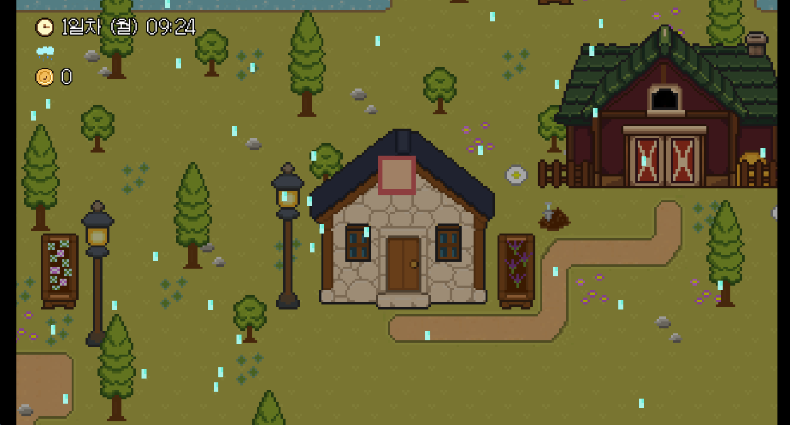

# Nightshade Meadow

농사·낚시·요리로 평화롭게 시작하지만, 어느 순간 마을 안의 스토커가 살인을 시작하는 2D 픽셀아트 힐링 시뮬레이션 × 호러 게임입니다.

- **플레이:** https://newjeans99.itch.io/nightshade-meadow
- **포트폴리오:** https://yj-kim-1028.github.io

## 개요

- 1인 개발: 기획, 구현, 테스트, 플레이테스트 반영, 출시까지 혼자 진행했습니다.
- 엔진과 언어: Godot 4, GDScript, 데이터는 JSON
- 규모: 맵 20개, NPC 13명, NPC 대사 약 2,500줄, GDScript 약 3만 줄
- 개발 방식: Claude Code로 개발했고, 프로젝트 규칙은 `CLAUDE.md`, 기획 문서는 `game_design/`, 세션별 작업 기록은 `plan/`에 있습니다.

## 폴더

| 폴더 | 내용 |
|---|---|
| `scripts/` | 게임 로직 (GDScript) |
| `scenes/` | Godot 씬 |
| `data/` | NPC 대사, 요리, 상점 등 JSON 데이터 |
| `game_design/` | 시스템, 호러, NPC 기획 문서 |
| `plan/` | 작업 기록 |

## 에셋

맵 20종과 도트 다수는 직접 제작했습니다. 일부 도트와 BGM은 AI 도구(PixelLab, Stable Audio)로 생성한 뒤 편집해 사용했습니다.
